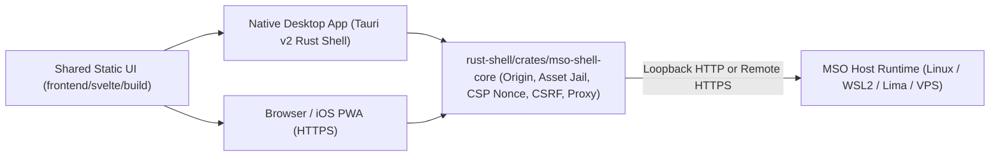

# Hybrid Svelte + Rust Shell Plan

> **Implementation contract & Stage R2A / Increment 2A record (2026-11-22).**
> Stage R0 (`rust-shell/` core + `shell-bridge.ts`) and **Stage R2A / Increment 2A** (real
> login/logout, 128-bit device ID, Owner device approvals/roles/revoke, Rust CSRF depth-2,
> bounded body limits, multi `Set-Cookie` forwarding) are implemented and verified on this
> branch. Production remains the Next.js/React cockpit until all parity and security gates pass.

## 1. Progress percentage tracker (formula-based, 2026-11-22)

Progress is computed strictly from weighted milestone gates (never guessed from line counts):

### A. Svelte Static Frontend Track (weight in hybrid program: 60%)

| Milestone | Weight | Status | Completion | Weighted |
|---|---|---|---|---|
| Increment 1: Static entry + monitor probe + `shell-bridge` | 10% | Merged on `main` (PR #285) + audited | 100% | 10.0% |
| Increment 2: Auth/devices/CSRF (2A done) + managed-host/OAuth/MCP parity (2B pending) | 15% | **2A landed on branch; 2B pending** | 60% | 9.0% |
| Increment 3: AppShell window manager + URL sync + Files + Terminal | 25% | Not started | 0% | 0.0% |
| Increment 4: Remaining 30 slices + 5 OS chromes + 10 AppShell features | 35% | Not started | 0% | 0.0% |
| Increment 5: Full Next cutover + same-host RSS/CPU/latency proof + rollback | 15% | Not started | 0% | 0.0% |
| **Total Svelte Track** | **100%** | **1 / 33 full slices (`auth` core) + 2 partial** | **19.0%** | **19.0%** |

### B. Rust Shell & Native Desktop Track (weight in hybrid program: 40%)

| Stage | Weight | Status | Completion | Weighted |
|---|---|---|---|---|
| **R0:** `mso-shell-core` + loopback static host + asset jail + nonce CSP | 15% | **Implemented on branch** | 100% | 15.0% |
| **R1:** Tauri v2 native desktop client (`mso-desktop-tauri`, Linux/macOS/Windows) | 25% | Planned (host lacks `webkit2gtk-4.1` / `gtk3` / `pkg-config`) | 0% | 0.0% |
| **R2:** Auth/CSRF/body/multi-cookie proxy (**R2A done**) + managed-host/WS upgrades (**R2B pending**) | 25% | **R2A landed on branch; R2B pending** | 50% | 12.5% |
| **R3:** Retire `next-server` + `scripts/server.mjs` in production | 20% | Planned (gated on Svelte Inc. 5) | 0% | 0.0% |
| **R4:** Selective native host primitives (aligned with [`NATIVE-HOST-RELAY.md`](./NATIVE-HOST-RELAY.md)) | 15% | Planned | 0% | 0.0% |
| **Total Rust Shell Track** | **100%** | **R0 + R2A verified live** | **27.5%** | **27.5%** |

### C. Combined Hybrid Program

- **Previous milestone (after Stage R0, 2026-11-21):** `0.60 * 10.0% + 0.40 * 15.0%` = **12.0%**
- **Current milestone (after Increment 2A + Stage R2A, 2026-11-22):** `0.60 * 19.0% + 0.40 * 27.5%` = **22.4% (~22%)**
- **When Native Desktop App becomes usable:** Completing **Stage R1 (Tauri v2)** brings combined progress to **~32%** and delivers a native desktop client (Linux/macOS/Windows) wrapping MSO even before all 33 Svelte slices are ported.
- **When production server RAM drops (~284 MiB -> <40 MiB):** Only at **100% cutover (Increment 5 + Stage R3)** when `next-server` + `scripts/server.mjs` are retired.

## 2. Why hybrid instead of a full Rust rewrite

Measured MSO baselines in [`MSO-MIGRATION.md`](./MSO-MIGRATION.md) and
[`BENCH-BEFORE.md`](./BENCH-BEFORE.md) show two separate bottlenecks that require two separate
solutions:

1. **Client UI latency is hydration-bound, not server-bound.**
   Live API TTFB is already 4-8 ms and HTML TTFB is 10-14 ms, while cold Slow 4G + 4x CPU
   desktop LCP is 3.0-3.2 s because of ~910 KiB raw (270.8 KiB gzip) first-load JS, of which
   47.9% (129.6 KiB gzip) is Next+React runtime. Rewriting the backend in Rust alone cannot move
   browser LCP; **Svelte 5 static output** attacks that critical path directly.
2. **Server footprint is runtime-bound.**
   The live Next cockpit uses ~284 MiB idle RSS (`next-server` 110 MiB + `scripts/server.mjs`
   174 MiB) and ~1.4-1.6 GiB `node_modules`. A standalone **Rust shell** solves native desktop
   packaging (Tauri v2) and low-RSS static/proxy serving without rewriting ~100k LOC of portable
   `lib/` orchestration, MCP, OAuth, and A2A code prematurely.

## 3. Target hybrid architecture (one UI -> Web/PWA + Native Desktop)



- **One frontend codebase:** `frontend/svelte/build` serves both Web/PWA and the Tauri v2 desktop
  WebView. Existing web-native surfaces (`xterm.js`, canvas/media editors, iframe managed apps,
  Camoufox noVNC, MCP Apps) remain compatible without reimplementing a second GUI stack.
- **Explicit host boundary:** Per [`PLATFORMS.md`](./PLATFORMS.md) and
  [`NATIVE-HOST-RELAY.md`](./NATIVE-HOST-RELAY.md), a Tauri desktop app on macOS or Windows
  operates first as a **native desktop client** connected to a verified Linux/WSL2/Lima/VPS MSO
  host. Native non-Linux host execution stays gated on real-machine OS adapter proofs.

## 4. Phased Rust shell roadmap

| Stage | Scope | Status | Prerequisites & acceptance gates |
|---|---|---|---|
| **R0** | **Rust shell core & loopback static host** (`mso-shell-core` + `mso-shell-host`, zero external crates): origin guard parity, canonicalized asset path-jail, per-request CSP nonce injection on SvelteKit HTML, plus `shell-bridge.ts`. | **Done (100%)** | `RUSTFLAGS="-D warnings" cargo test --workspace`, `cargo build --release`, `bun run test:rust-host`. |
| **R1** | **Tauri v2 native desktop client shell** (`rust-shell/crates/mso-desktop-tauri`): embeds `frontend/svelte/build` + `mso-shell-core`, native window chrome, system tray, host profile switcher (loopback WSL2/Lima or remote HTTPS MSO host), OS deep links, updater. | **Planned (0%)** | Linux build packages (`pkg-config`, `libwebkit2gtk-4.1-dev`, `libgtk-3-dev`, `libayatana-appindicator3-dev`), crates.io access, plus real-machine smoke proofs on Linux, macOS, and Windows. |
| **R2** | **R2A (Done):** CSRF depth-2 (`csrf.rs` parity with `proxy.ts`), bounded HTTP request body reader (`413`), multi `Set-Cookie` forwarding, and auth/devices route policy (`/api/auth/me`, `login`, `logout`, `devices`, `/api/v1/sys/stats`). **R2B (Next):** Managed-app split-origin host rewrites, OAuth/MCP machine-protocol passthrough, and WebSocket upgrades (`term/*`, Camoufox noVNC, managed apps). | **In progress (50% - R2A done)** | Parity against `proxy.ts` test suites (`proxy.test.ts`, `proxy-framing.test.ts`, `proxy-websocket.test.ts`, `proxy-machine-protocol.test.ts`); zero second login or cookie-domain drift. |
| **R3** | **Retire `next-server` + `scripts/server.mjs`** (paired with Svelte Increments 3-5): serve static Svelte UI and full edge/WS proxy from the Rust shell while routing `lib/` API/MCP handlers to a single lean runtime process without Next SSR. | **Planned (0%)** | Full 33-slice Svelte parity cutover gate, exact-host RSS/CPU/latency benchmark on identical workload, supported `mso update` / rollback path. |
| **R4** | **Selective native host primitives** (aligned with [`NATIVE-HOST-RELAY.md`](./NATIVE-HOST-RELAY.md)): evaluate porting high-I/O host calls (`fs` jail/search, `sys` metrics, `portable-pty`, outbound relay) where measured gains justify dual-language maintenance. | **Planned (0%)** | Measured CPU/RSS/latency win on the same host; strict containment & credential denylist parity; do not port `lib/orchestration` prematurely. |

## 5. Measured evidence (Stage R2A / Increment 2A, 2026-11-22)

Captured on Linux x86_64 (`rustc 1.99.1`, `node v24.22.2`, `bun 1.4.2`, Chromium headless) against
synthetic fixtures on `feat/hybrid-svelte-rust-shell`. These figures prove **Stage R2A static host
and Increment 2A auth/devices/monitor behavior only** and must not be represented as full
33-slice cockpit parity.

| Measurement | Stage R0 (2026-11-21) | Stage R2A / Inc. 2A (2026-11-22) | Scope / caveat |
|---|---|---|---|
| `mso-shell-host` release binary | 375 KiB | **383 KiB** (+8 KiB) | Stripped, LTO, 0 external crates; now includes CSRF depth-2, bounded body parser, 5-route policy, multi `Set-Cookie`. |
| `mso-shell-host` idle / active `VmRSS` | 2,416 / 2,860 KiB | **2,420 KiB (~2.4 MiB)** / **2,788 KiB (~2.7 MiB)** | `/proc/<pid>/status` during live Chromium login -> owner approve -> logout; excludes backend API process. |
| Security & protocol boundaries | Nonce CSP, traversal `400`, `404`/`405` | **+ CSRF `403`, oversized body `413`, multi `Set-Cookie`, live auth+device flow** | 14/14 Rust unit tests + live Chromium `test:rust-host` (`0` console/page errors). |
| Svelte static build output | 160 KiB dir / 35.3 KiB JS gzip | **176 KiB** dir / **41.4 KiB JS gzip** (client build 209 ms) | Added full `auth` core slice (`LoginForm`, `DevicesPanel`, `device.ts`, `devices-controller.ts`): +6.1 KiB JS gzip. |
| Svelte unit & browser checks | 20 unit tests + Inc. 1 E2E | **26/26 unit tests** + **Inc. 1 + 2A Chromium E2E PASS** | Covers 320/390/1440 px light+dark, 200% zoom, bad-password, pending, owner approve/role/inline-revoke, logout, CSRF `403`. |
| Svelte cold load (Slow 4G + 4x CPU, `perf:probe`) | Desktop LCP 804 ms / TBT 11 ms; Mobile LCP 802 ms / TBT 22 ms / CLS 0.0515 | **Desktop: FCP/LCP 820 ms, TBT 16 ms, CLS 0.0078; Mobile: FCP/LCP 824 ms, TBT 18 ms, CLS 0.0515** | 107.9 KiB raw JS / 43.6 KiB transfer, 52 DOM nodes; fixed mobile header CLS regression (`0.3388 -> 0.0515`). |

## 6. Explicit boundaries and non-goals

- Production remains Next.js/React (`mso.service`, installers, state, tunnels, and host policy are
  untouched by Stage R0/R2A).
- `rust-shell/` binds strictly to `127.0.0.1` and never widens CORS, cookie domains, or public
  bind addresses.
- No desktop client or native OS parity claim is valid until built and verified on real Linux,
  macOS, and Windows machines under Stage R1 / [`NATIVE-HOST-RELAY.md`](./NATIVE-HOST-RELAY.md).

## 7. Local verification commands

```sh
# 1. Svelte static entry + auth/devices unit tests + browser E2E + cold-load probe
bun run svelte:check
bun run svelte:build
bun run svelte:e2e
cd frontend/svelte && bun run perf:probe

# 2. Rust shell Stage R2A unit tests + release binary + live Chromium/RSS proof
cd rust-shell && RUSTFLAGS="-D warnings" cargo test --workspace && cargo build --release
cd ../frontend/svelte && bun run test:rust-host
```
