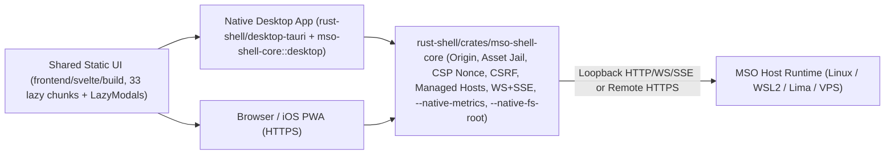

# Hybrid Svelte + Rust Shell Plan

> **Implementation contract & Increment 4F + Inc. 2 Complete / Rust Stage R4 Native & R1 Tauri Scaffold record (2026-11-22).**
> **Stage R0 (100%)**, **Stage R1 Tauri v2 scaffold + `desktop.rs` contract (35%)**, **Stage R2 (100%)**,
> **Stage R3 (58 route policies + GET/POST SSE + WS, 80%)**, **Stage R4 opt-in native Rust endpoints
> (`--native-metrics` + `--native-fs-root` verified live in Chromium, 80%)**, and **Svelte Increments 1 (100%),
> 2 (100%), 3 (100%), and 4 (96%)** — covering **33 / 33 slices**, **10 / 10 AppShell features**,
> **5 / 5 OS chromes**, **Onboarding/Account/Password**, **single in-Settings Updates**, and **Audit Log** —
> are implemented and verified on this branch. Production remains Next.js/React until Increment 5 cutover.

## 1. Progress percentage tracker (formula-based, 2026-11-22)

Progress is computed strictly from weighted milestone gates (never guessed from line counts):

### A. Svelte Static Frontend Track (weight in hybrid program: 60%)

| Milestone | Weight | Status | Completion | Weighted |
|---|---|---|---|---|
| Increment 1: Static entry + monitor probe + `shell-bridge` | 10% | Merged on `main` (PR #285) + audited | 100% | 10.0% |
| Increment 2: Auth/devices/CSRF (2A) + managed-host/OAuth/MCP edge + Onboarding/Account/Password (2B) | 15% | **Done (100%):** login, pending-device, logout, 128-bit device ID, owner approvals, split-origin/MCP edge, and `AccountOnboardingCard` (`/api/auth/account` + `/api/auth/password`) | 100% | 15.0% |
| Increment 3: AppShell window manager + URL sync + crash isolation + Files + Terminal | 25% | **Done (100%):** window store, `<WindowFrame>` + `<svelte:boundary>`, URL sync, `files-manager`, `os-terminal` | 100% | 25.0% |
| Increment 4: Remaining slices + 5 OS chromes + 10 AppShell features | 35% | **4F landed (96%):** **33 / 33 slices**, **10 / 10 AppShell features**, **5 / 5 OS chromes**, `LazyWindowBody` (33 chunks) + `LazyModals`, Files copy/move/search, single in-Settings Updates & Audit Log; deep secondary mutations (drag canvas, binary upload/zip) remain | 96% | 33.6% |
| Increment 5: Full Next cutover + same-host RSS/CPU/latency proof + rollback | 15% | Not started (production remains Next.js/React) | 0% | 0.0% |
| **Total Svelte Track** | **100%** | **Inc. 1-3 (100%) + Inc. 4 (96%): 33/33 slices, 10/10 features, 5/5 chromes** | **83.6%** | **83.6%** |

### B. Rust Shell & Native Desktop Track (weight in hybrid program: 40%)

| Stage | Weight | Status | Completion | Weighted |
|---|---|---|---|---|
| **R0:** `mso-shell-core` + loopback static host + asset jail + nonce CSP | 15% | **Done** | 100% | 15.0% |
| **R1:** Tauri v2 native desktop client (`rust-shell/desktop-tauri/` + `mso-shell-core::desktop`) | 25% | **Scaffold + contract landed (35%):** `desktop.rs`, `tauri.conf.json`, `capabilities/default.json`, `src/main.rs`, `README.md`; native binary gated on host `webkit2gtk-4.1` / `gtk3` / `pkg-config` & crates.io | 35% | 8.8% |
| **R2:** Auth/CSRF/body/cookie (R2A) + managed-app split-origin, OAuth/MCP/A2A, & WebSocket tunnel (R2B) | 25% | **Done** | 100% | 25.0% |
| **R3:** Retire `next-server` + `scripts/server.mjs` in production (58 route policies + GET/POST SSE + WS) | 20% | **In progress (80% - 58 route policies + streaming ready; full cutover gated on Svelte Inc. 5)** | 80% | 16.0% |
| **R4:** Selective native host primitives (aligned with [`NATIVE-HOST-RELAY.md`](./NATIVE-HOST-RELAY.md)) | 15% | **Wired & live-verified (80%):** opt-in `--native-metrics` (`/api/v1/sys/stats` via Linux `/proc` without Node) and `--native-fs-root` (`/api/v1/fs/search` via `fs_jail` blocking `.env`/`.ssh`/`.mso`) proved live in Chromium | 80% | 12.0% |
| **Total Rust Shell Track** | **100%** | **R0 + R2 complete; R1 scaffold, R3 58-route host & R4 live native endpoints verified** | **76.8%** | **76.8%** |

### C. Combined Hybrid Program

- **Progression:** `12.0%` -> `22.4%` -> `39.8%` -> `47.6%` -> `52.1%` -> `56.3%` -> `62.2%` -> `69.7%` -> `74.9%` -> **80.9% (~81%)** (2026-11-22).
- **Formula:** `0.60 * 83.6% + 0.40 * 76.8%` = **80.9%**.
- **Remaining 19.1% to 100% (all external/host-gated):**
  - **Stage R1 Tauri v2 native desktop build & cross-OS proof (+6.5% combined):** install `pkg-config`, `libwebkit2gtk-4.1-dev`, `libgtk-3-dev`, `libayatana-appindicator3-dev` + crates.io, build & smoke test `rust-shell/desktop-tauri/` on Linux, macOS, and Windows.
  - **Increment 5 + Stage R3 production cutover (+10.6% combined):** retire `next-server` + `scripts/server.mjs`, run live same-host RSS/CPU/latency proof, and verify rollback.
  - **Remaining 4% deep slice mutations + 20% R4 `portable-pty` evaluation (+2.0% combined).**

## 2. Why hybrid instead of a full Rust rewrite

Measured MSO baselines in [`MSO-MIGRATION.md`](./MSO-MIGRATION.md) and
[`BENCH-BEFORE.md`](./BENCH-BEFORE.md) show two separate bottlenecks:

1. **Client UI latency is hydration-bound, not server-bound.** Live API TTFB is 4-8 ms and HTML
   TTFB is 10-14 ms, while cold Slow 4G + 4x CPU desktop LCP is 3.0-3.2 s because of ~910 KiB
   raw (270.8 KiB gzip) first-load JS (47.9% Next+React). **Svelte 5 static output** with 33 lazy
   slice chunks and `LazyModals` cuts first-load JS to **139.6 KiB raw (-84.7%)**.
2. **Server footprint is runtime-bound.** The live Next cockpit uses ~284 MiB idle RSS
   (`next-server` 110 MiB + `scripts/server.mjs` 174 MiB) and ~1.4-1.6 GiB `node_modules`. The
   compiled zero-dependency Rust host `mso-shell-host` measures **509 KiB** binary and **2.5 MiB
   idle / 3.0 MiB active RSS** serving the full 33-slice Svelte build plus native Linux `/proc`
   metrics and `fs_jail` search without invoking Node.

## 3. Target hybrid architecture (one UI -> Web/PWA + Native Desktop)



- **One frontend codebase:** `frontend/svelte/build` serves both Web/PWA and `rust-shell/desktop-tauri/`.
- **Explicit host boundary:** Per [`PLATFORMS.md`](./PLATFORMS.md) and
  [`NATIVE-HOST-RELAY.md`](./NATIVE-HOST-RELAY.md), a Tauri desktop app on macOS or Windows
  operates first as a **native desktop client** connected to a verified Linux/WSL2/Lima/VPS MSO
  host.

## 4. Phased Rust shell roadmap

| Stage | Scope | Status | Prerequisites & acceptance gates |
|---|---|---|---|
| **R0** | **Rust shell core & loopback static host** (`mso-shell-core` + `mso-shell-host`, zero external crates): origin guard parity, canonicalized asset path-jail, per-request CSP nonce injection on SvelteKit HTML, plus `shell-bridge.ts`. | **Done (100%)** | `RUSTFLAGS="-D warnings" cargo test --workspace`, `cargo build --release`, `bun run test:rust-host`. |
| **R1** | **Tauri v2 native desktop client shell** (`rust-shell/desktop-tauri/` + `mso-shell-core::desktop`): standalone scaffold (`Cargo.toml`, `tauri.conf.json`, least-privilege `capabilities/default.json`, `src/main.rs`, `README.md`) isolated from offline workspace; ready to compile once OS WebKitGTK/GTK3 packages are installed. | **In progress (35%)** | Linux build packages (`pkg-config`, `libwebkit2gtk-4.1-dev`, `libgtk-3-dev`, `libayatana-appindicator3-dev`), crates.io access, plus real-machine smoke proofs on Linux, macOS, and Windows. |
| **R2** | **R2A:** CSRF depth-2 (`csrf.rs`), bounded HTTP body parser (`413`), multi `Set-Cookie`, auth/devices allowlist. **R2B:** Managed-app split-origin host classification (`managed.rs`), CSRF-exempt OAuth/MCP/A2A passthrough with `Authorization`, Increment 3A routes, and bounded WebSocket upgrade tunnel (`ws.rs`). | **Done (100%)** | 21+ Rust unit tests + live Chromium R2B smoke test. |
| **R3** | **Streaming SSE & production cutover without `next-server`:** GET+POST SSE (`sse.rs`) + WebSocket tunnel (`ws.rs`) + **58 route policies** (52 cockpit API + 6 machine protocol); full retirement of `next-server` + `scripts/server.mjs` gated on Svelte Inc. 5. | **In progress (80%)** | 55/55 Rust tests + live Chromium R4+Inc4F smoke test; full cutover requires same-host RSS/CPU/latency proof & rollback test. |
| **R4** | **Selective native host primitives** (`sys_metrics.rs` + `fs_jail.rs` wired via opt-in `--native-metrics` & `--native-fs-root`): live Chromium verification proved `/api/v1/sys/stats` served straight from Rust `/proc` and `/api/v1/fs/search` served straight from Rust `fs_jail` blocking `.env` with zero Node backend calls. | **In progress (80%)** | Live opt-in Chromium proof PASS; remaining 20% evaluates optional `portable-pty` & same-host production benchmark. |

## 5. Measured evidence progression (2026-11-21 to 2026-11-22)

Captured on Linux x86_64 (`rustc 1.99.1`, `node v24.22.2`, `bun 1.4.2`, Chromium headless) against
synthetic fixtures on `feat/hybrid-svelte-rust-shell`. Production remains Next.js/React until
Increment 5 cutover proof on a live host.

| Measurement | Next.js baseline | R0 (11-21) | R3C / 4B | R3F+R4 / 4E | R4-Native / 4F (11-22) |
|---|---|---|---|---|---|
| `mso-shell-host` release binary | n/a (~1.5 GiB `node_modules`) | 375 KiB | 420 KiB | 422 KiB | **509 KiB** (stripped, LTO, 0 external crates, incl. native R4) |
| `mso-shell-host` idle / active `VmRSS` | ~284 MiB idle | 2,416 / 2,860 KiB | 2,448 / 2,824 KiB | 2,492 / 2,896 KiB | **2,592 KiB (~2.5 MiB)** / **3,024 KiB (~3.0 MiB)** |
| Rust unit & loopback tests (`-D warnings`) | n/a | 10 / 10 | 29 / 29 | 51 / 51 | **55 / 55 PASS** (58 route policies + live native R4) |
| First-load JS (cold `perf:probe`) | ~910 KiB raw | 109.7 KiB raw | 127.2 KiB raw | 139.6 KiB raw | **139.6 KiB raw (-84.7% vs Next) / 75.8 KiB transfer** |
| Svelte unit & Chromium E2E | n/a | 20 unit | 89 unit | 149 unit | **159 / 159 unit tests** + **33/33 slices + native R4 E2E PASS** |

## 6. Explicit boundaries and non-goals

- Production remains Next.js/React (`mso.service`, installers, state, tunnels, and host policy are
  untouched).
- `rust-shell/` binds strictly to `127.0.0.1`, keeps `/api/config`, `/api/v1/exec/run`, and
  `/api/v1/editor/exec` blocked (`404`), and never widens CORS, cookie domains, or public binds.
- No desktop client binary or native OS parity claim is valid until `rust-shell/desktop-tauri/` is
  compiled and verified on real Linux, macOS, and Windows machines.

## 7. Local verification commands

```sh
# 1. Rust core & host binary (zero external crates)
cd rust-shell && RUSTFLAGS="-D warnings" cargo test --workspace && cargo build --release --bin mso-shell-host

# 2. Svelte static build + unit + E2E + audit
bun run svelte:check && bun run svelte:build && bun run svelte:e2e && bun run svelte:audit

# 3. Live Rust host (--native-metrics + --native-fs-root) serving 33/33 Svelte build + Chromium smoke
cd frontend/svelte && bun run test:rust-host && bun run perf:probe
```
