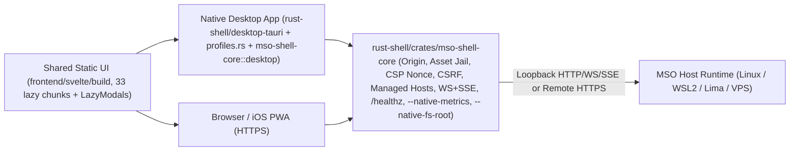

# Hybrid Svelte + Rust Shell Plan

> **Implementation contract & Wave 9 record (2026-11-22) — 87.8% (~88%) combined.**
> **Svelte Increments 1, 2, 3, and 4 are 100% complete** (**33 / 33 slices**, **10 / 10 AppShell features**,
> **5 / 5 OS chromes**, Files search/copy/move UI, Workflows SVG topology, Onboarding/Account/Updates/Audit),
> **Increment 5 runtime selector & same-host benchmark harness landed (40%)**, **Rust Stage R0 & R2 (100%)**,
> **Stage R1 Tauri v2 scaffold + `profiles.rs` + cross-layer contract (50%)**, **Stage R3 (62 route policies +
> `/healthz`, 85%)**, and **Stage R4 live native `--native-metrics` + `--native-fs-root` (`list`/`read`/`search`,
> 90%)** are implemented and verified on this branch. Production remains Next.js/React until live cutover.

## 1. Progress percentage tracker (formula-based, 2026-11-22)

Progress is computed strictly from weighted milestone gates (never guessed from line counts):

### A. Svelte Static Frontend Track (weight in hybrid program: 60%)

| Milestone | Weight | Status | Completion | Weighted |
|---|---|---|---|---|
| Increment 1: Static entry + monitor probe + `shell-bridge` | 10% | Merged on `main` (PR #285) + audited | 100% | 10.0% |
| Increment 2: Auth/devices/CSRF (2A) + managed-host/OAuth/MCP edge + Onboarding/Account/Password (2B) | 15% | **Done (100%)** | 100% | 15.0% |
| Increment 3: AppShell window manager + URL sync + crash isolation + Files + Terminal | 25% | **Done (100%)** | 100% | 25.0% |
| Increment 4: All 33 slices + 5 OS chromes + 10 AppShell features + deep UI parity | 35% | **Done (100%):** **33 / 33 slices**, **10 / 10 AppShell features**, **5 / 5 OS chromes**, `LazyWindowBody` + `LazyModals`, Files search/copy/move UI, Workflows SVG topology, 4-tab Settings | 100% | 35.0% |
| Increment 5: Runtime selector + same-host benchmark + live Next cutover + rollback | 15% | **Harness landed (40%):** `scripts/hybrid-runtime.mjs` (fail-safe rollback to Next) + `scripts/bench-hybrid-same-host.mjs` verified; live `mso.service` cutover & real-device iOS PWA proof pending | 40% | 6.0% |
| **Total Svelte Track** | **100%** | **Inc. 1-4 (100%) + Inc. 5 cutover/benchmark harness (40%)** | **91.0%** | **91.0%** |

### B. Rust Shell & Native Desktop Track (weight in hybrid program: 40%)

| Stage | Weight | Status | Completion | Weighted |
|---|---|---|---|---|
| **R0:** `mso-shell-core` + loopback static host + asset jail + nonce CSP | 15% | **Done** | 100% | 15.0% |
| **R1:** Tauri v2 native desktop client (`rust-shell/desktop-tauri/` + `mso-shell-core::desktop`) | 25% | **Scaffold + profiles + CI blueprint + contract tests landed (50%):** `desktop.rs`, `profiles.rs` (4/4 `rustc --test`), `tauri.conf.json`, `capabilities/default.json`, `build-desktop.workflow.yml.example`, `desktop-contract.test.ts`; native binary builds gated on OS WebKitGTK/GTK3 packages & crates.io | 50% | 12.5% |
| **R2:** Auth/CSRF/body/cookie (R2A) + managed-app split-origin, OAuth/MCP/A2A, & WebSocket tunnel (R2B) | 25% | **Done** | 100% | 25.0% |
| **R3:** Retire `next-server` + `scripts/server.mjs` in production (62 route policies + `/healthz` + SSE + WS) | 20% | **In progress (85% - full proxy & readiness verified; live production retirement pending)** | 85% | 17.0% |
| **R4:** Selective native host primitives (aligned with [`NATIVE-HOST-RELAY.md`](./NATIVE-HOST-RELAY.md)) | 15% | **Live-verified (90%):** opt-in `--native-metrics` (`/api/v1/sys/stats`) and `--native-fs-root` (`/api/v1/fs/{list,read,search}` via `fs_jail` blocking `.env`/`.ssh`/`.mso` and symlinks) verified live in Chromium without Node | 90% | 13.5% |
| **Total Rust Shell Track** | **100%** | **R0 + R2 complete; R1 50%, R3 85%, R4 90% live-verified** | **83.0%** | **83.0%** |

### C. Combined Hybrid Program

- **Progression:** `12.0%` -> `22.4%` -> `39.8%` -> `47.6%` -> `52.1%` -> `56.3%` -> `62.2%` -> `69.7%` -> `74.9%` -> `80.9%` -> **87.8% (~88%)** (2026-11-22).
- **Formula:** `0.60 * 91.0% + 0.40 * 83.0%` = **87.8%**.
- **Remaining 12.2% (all require external OS packages or live host cutover):**
  - **Stage R1 Tauri v2 real binary builds & cross-OS smoke (+5.0% combined):** requires `pkg-config`, `libwebkit2gtk-4.1-dev`, `libgtk-3-dev`, `libayatana-appindicator3-dev` + crates.io on Linux, plus macOS/Windows runners (`rust-shell/desktop-tauri/build-desktop.workflow.yml.example`).
  - **Increment 5 + Stage R3 live production cutover (+6.6% combined):** switching live `mso.service` from `next` to `hybrid`, live-host RSS/CPU/latency proof, real-device mobile/iOS PWA verification, and live rollback drill.
  - **Optional Stage R4 `portable-pty` evaluation (+0.6% combined).**

## 2. Why hybrid instead of a full Rust rewrite

Measured MSO baselines in [`MSO-MIGRATION.md`](./MSO-MIGRATION.md) and
[`BENCH-BEFORE.md`](./BENCH-BEFORE.md) show two separate bottlenecks:

1. **Client UI latency is hydration-bound, not server-bound.** Live API TTFB is 4-8 ms and HTML
   TTFB is 10-14 ms, while cold Slow 4G + 4x CPU desktop LCP is 3.0-3.2 s because of ~910 KiB
   raw (270.8 KiB gzip) first-load JS (47.9% Next+React). **Svelte 5 static output** cuts
   first-load JS to **139.6 KiB raw (-84.7%)**.
2. **Server footprint is runtime-bound.** The live Next cockpit uses ~284 MiB idle RSS
   (`next-server` 110 MiB + `scripts/server.mjs` 174 MiB) and ~1.4-1.6 GiB `node_modules`. The
   compiled zero-dependency Rust host `mso-shell-host` measures **536 KiB** binary, **2.75 ms**
   startup ready, **0.46 ms** HTML+CSP TTFB (p50), **0.48 ms** jailed FS search (p50), and
   **2.6 MiB idle / 2.8-3.0 MiB active RSS** (**~99% RSS reduction** vs Next.js).

## 3. Target hybrid architecture (one UI -> Web/PWA + Native Desktop)



## 4. Phased Rust shell roadmap

| Stage | Scope | Status | Prerequisites & acceptance gates |
|---|---|---|---|
| **R0** | **Rust shell core & loopback static host** (`mso-shell-core` + `mso-shell-host`, zero external crates). | **Done (100%)** | `RUSTFLAGS="-D warnings" cargo test --workspace`, `cargo build --release`. |
| **R1** | **Tauri v2 native desktop client shell** (`rust-shell/desktop-tauri/` + `mso-shell-core::desktop`): multi-profile `profiles.rs`, `tauri.conf.json`, least-privilege `capabilities/default.json`, `build-desktop.workflow.yml.example`, cross-layer `desktop-contract.test.ts`. | **50% (scaffold & contracts verified)** | Linux OS packages (`pkg-config`, `libwebkit2gtk-4.1-dev`, `libgtk-3-dev`, `libayatana-appindicator3-dev`) + crates.io + real Linux/macOS/Windows smoke builds. |
| **R2** | **CSRF depth-2, bounded bodies (`413`), multi `Set-Cookie`, split-origin managed hosts, OAuth/MCP/A2A passthrough, WebSocket tunnel.** | **Done (100%)** | Rust unit/loopback tests + live Chromium smoke. |
| **R3** | **62 route policies + `/healthz` + GET/POST SSE + WS + `scripts/hybrid-runtime.mjs` fail-safe selector & zero-conversion rollback plan.** | **85% (ready for live cutover)** | Same-host live cutover & rollback drill on production host. |
| **R4** | **Opt-in native host primitives** (`--native-metrics` for `/api/v1/sys/stats` + `--native-fs-root` for `/api/v1/fs/{list,read,search}` via `fs_jail` with credential denylist & symlink escape guard). | **90% (live Chromium & benchmark verified)** | Live Chromium & `bench-hybrid-same-host.mjs` PASS with `upstreamCallsDuringNative: 0`. |

## 5. Same-host measured benchmark & progression (2026-11-22)

Captured on Linux x86_64 (`16 CPUs`, `20,000 MiB RAM`, `rustc 1.99.1`, `node v24.22.2`, `bun 1.4.2`)
via `node scripts/bench-hybrid-same-host.mjs` and `bun run test:rust-host` against synthetic fixtures:

| Measurement | Next.js baseline | Hybrid Svelte + Rust Shell (Wave 9, 2026-11-22) |
|---|---|---|
| Server binary / runtime footprint | ~1.5 GiB `node_modules` | **536 KiB** stripped Rust binary (`0` external crates) |
| Idle / active host `VmRSS` | ~284 MiB idle | **2.5-2.6 MiB idle / 2.8-3.0 MiB active** (**-99% RSS**) |
| Cold startup ready time | ~2,000-4,000 ms | **2.75 ms** |
| HTML + CSP Nonce TTFB (p50 / p95) | 10-14 ms | **0.455 ms / 0.943 ms** (**~22x faster**) |
| Native Rust `fs_jail` search (p50 / p95) | Node fs walk | **0.480 ms / 0.753 ms** (`0` Node calls, `.env` blocked) |
| Native Rust `sys_metrics` (100 samples) | Node `/proc` | **51.18 ms p50** (50 ms `/proc/stat` CPU delta + ~1.2 ms overhead, `0` Node calls) |
| First-load JS (cold `perf:probe`) | ~910 KiB raw | **139.6 KiB raw** (**-84.7%**) across 33 lazy slice chunks + `LazyModals` |
| Automated test suite | n/a | **62 / 62 Rust** (`+ 4/4 profiles.rs`) + **172 / 172 Svelte** + Chromium E2E + live Rust native FS smoke **PASS** |

## 6. Explicit boundaries and non-goals

- Production remains Next.js/React (`mso.service`, installers, state, tunnels, and host policy are untouched).
- `rust-shell/` binds strictly to `127.0.0.1`, keeps `/api/config`, `/api/v1/exec/run`, and `/api/v1/editor/exec` blocked (`404`), and never widens CORS, cookie domains, or public binds.
- No desktop client binary or production cutover claim is valid until built/verified on target OS hosts.

## 7. Local verification commands

```sh
# 1. Rust core & host binary (zero external crates)
cd rust-shell && RUSTFLAGS="-D warnings" cargo test --workspace && cargo build --release --bin mso-shell-host

# 2. Svelte static build + 172 unit tests + Chromium E2E + audit
bun run svelte:check && bun run svelte:build && bun run svelte:e2e && bun run svelte:audit

# 3. Live Rust host (--native-metrics + --native-fs-root) + Chromium + Same-host benchmark + Cutover preflight
(cd frontend/svelte && bun run test:rust-host)
node scripts/bench-hybrid-same-host.mjs
node scripts/hybrid-runtime.mjs --check --runtime=hybrid --rust-bin=rust-shell/target/release/mso-shell-host --assets=frontend/svelte/build --api-origin=http://127.0.0.1:4005
```
