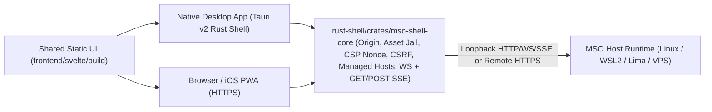

# Hybrid Svelte + Rust Shell Plan

> **Implementation contract & Increment 4A / Rust Stage R3B record (2026-11-22).**
> **Stage R0**, **Stage R2 (100%)**, **Stage R3B (GET+POST SSE streaming proxy & 23 reviewed routes)**,
> and **Svelte Increments 1, 2 (90%), 3 (100%), and 4A (22%)** — covering core `auth`, AppShell
> window manager + `<svelte:boundary>` + URL sync, full `files-manager`, `os-terminal`, complete
> `system-monitor` (stats + processes + services + read-only packages), `assistant` (Alfa POST SSE),
> `os-settings` + `quicklinks`, and `managed-apps` — are implemented and verified on this branch.
> Production remains Next.js/React until cutover.

## 1. Progress percentage tracker (formula-based, 2026-11-22)

Progress is computed strictly from weighted milestone gates (never guessed from line counts):

### A. Svelte Static Frontend Track (weight in hybrid program: 60%)

| Milestone | Weight | Status | Completion | Weighted |
|---|---|---|---|---|
| Increment 1: Static entry + monitor probe + `shell-bridge` | 10% | Merged on `main` (PR #285) + audited | 100% | 10.0% |
| Increment 2: Auth/devices/CSRF (2A) + managed-host/OAuth/MCP edge parity (2B) | 15% | **2A & 2B edge landed; first-login onboarding sub-flow pending** | 90% | 13.5% |
| Increment 3: AppShell window manager + URL sync + crash isolation + Files + Terminal | 25% | **Done (100%):** window store, `<WindowFrame>` + `<svelte:boundary>`, URL sync, full `files-manager`, `os-terminal` (PTY + base64 SSE) | 100% | 25.0% |
| Increment 4: Remaining slices + 5 OS chromes + 10 AppShell features | 35% | **4A landed (22%):** complete `system-monitor` (4/4 incl. read-only packages), `assistant` (Alfa POST SSE + models), `os-settings` core + `quicklinks` (`/api/prefs`), `managed-apps`; 24 slices, 5 OS chromes & 10 shell features pending | 22% | 7.7% |
| Increment 5: Full Next cutover + same-host RSS/CPU/latency proof + rollback | 15% | Not started | 0% | 0.0% |
| **Total Svelte Track** | **100%** | **8 / 33 slices + `appshell` window mgr** | **56.2%** | **56.2%** |

### B. Rust Shell & Native Desktop Track (weight in hybrid program: 40%)

| Stage | Weight | Status | Completion | Weighted |
|---|---|---|---|---|
| **R0:** `mso-shell-core` + loopback static host + asset jail + nonce CSP | 15% | **Done** | 100% | 15.0% |
| **R1:** Tauri v2 native desktop client (`mso-desktop-tauri`, Linux/macOS/Windows) | 25% | Planned (host lacks `webkit2gtk-4.1` / `gtk3` / `pkg-config`) | 0% | 0.0% |
| **R2:** Auth/CSRF/body/cookie (R2A) + managed-app split-origin, OAuth/MCP/A2A, & WebSocket tunnel (R2B) | 25% | **Done** | 100% | 25.0% |
| **R3:** Retire `next-server` + `scripts/server.mjs` in production (R3B: GET+POST SSE `sse.rs` + 23 routes landed) | 20% | **In progress (30% - GET+POST SSE streaming ready; full cutover gated on Svelte Inc. 5)** | 30% | 6.0% |
| **R4:** Selective native host primitives (aligned with [`NATIVE-HOST-RELAY.md`](./NATIVE-HOST-RELAY.md)) | 15% | Planned | 0% | 0.0% |
| **Total Rust Shell Track** | **100%** | **R0 + R2 complete; R3B GET+POST SSE verified** | **46.0%** | **46.0%** |

### C. Combined Hybrid Program

- **After Stage R0 (2026-11-21):** **12.0%**
- **After Increment 2A + Stage R2A (2026-11-22):** **22.4%**
- **After Increment 2B/3A + Stage R2B (2026-11-22):** **39.8%**
- **After Increment 3B + Rust SSE (2026-11-22):** **47.6%**
- **Current (after Increment 4A + Rust Stage R3B, 2026-11-22):** `0.60 * 56.2% + 0.40 * 46.0%` = **52.1% (~52%)**
- **When Native Desktop App becomes usable:** Completing **Stage R1 (Tauri v2)** adds +10% combined (~62%) and delivers a native desktop client (Linux/macOS/Windows) wrapping MSO.
- **When production server RAM drops (~284 MiB -> <40 MiB):** Only at **100% cutover (Increment 5 + Stage R3)** when `next-server` + `scripts/server.mjs` are retired.

## 2. Why hybrid instead of a full Rust rewrite

Measured MSO baselines in [`MSO-MIGRATION.md`](./MSO-MIGRATION.md) and
[`BENCH-BEFORE.md`](./BENCH-BEFORE.md) show two separate bottlenecks:

1. **Client UI latency is hydration-bound, not server-bound.** Live API TTFB is 4-8 ms and HTML
   TTFB is 10-14 ms, while cold Slow 4G + 4x CPU desktop LCP is 3.0-3.2 s because of ~910 KiB
   raw (270.8 KiB gzip) first-load JS (47.9% Next+React). **Svelte 5 static output** attacks
   that critical path directly.
2. **Server footprint is runtime-bound.** The live Next cockpit uses ~284 MiB idle RSS
   (`next-server` 110 MiB + `scripts/server.mjs` 174 MiB) and ~1.4-1.6 GiB `node_modules`. A
   standalone **Rust shell** solves native desktop packaging (Tauri v2) and low-RSS static/proxy
   serving without rewriting ~100k LOC of portable `lib/` orchestration, MCP, OAuth, and A2A code
   prematurely.

## 3. Target hybrid architecture (one UI -> Web/PWA + Native Desktop)



- **One frontend codebase:** `frontend/svelte/build` serves both Web/PWA and the Tauri v2 desktop
  WebView. Existing web-native surfaces (`xterm.js`, canvas/media editors, iframe managed apps,
  Camoufox noVNC, MCP Apps) remain compatible without reimplementing a second GUI stack.
- **Explicit host boundary:** Per [`PLATFORMS.md`](./PLATFORMS.md) and
  [`NATIVE-HOST-RELAY.md`](./NATIVE-HOST-RELAY.md), a Tauri desktop app on macOS or Windows
  operates first as a **native desktop client** connected to a verified Linux/WSL2/Lima/VPS MSO
  host. Native non-Linux host execution stays gated on real-machine OS adapter proofs.

## 4. Phased Rust shell roadmap

| Stage | Scope | Status | Prerequisites & acceptance gates |
|---|---|---|---|
| **R0** | **Rust shell core & loopback static host** (`mso-shell-core` + `mso-shell-host`, zero external crates): origin guard parity, canonicalized asset path-jail, per-request CSP nonce injection on SvelteKit HTML, plus `shell-bridge.ts`. | **Done (100%)** | `RUSTFLAGS="-D warnings" cargo test --workspace`, `cargo build --release`, `bun run test:rust-host`. |
| **R1** | **Tauri v2 native desktop client shell** (`rust-shell/crates/mso-desktop-tauri`): embeds `frontend/svelte/build` + `mso-shell-core`, native window chrome, system tray, host profile switcher (loopback WSL2/Lima or remote HTTPS MSO host), OS deep links, updater. | **Planned (0%)** | Linux build packages (`pkg-config`, `libwebkit2gtk-4.1-dev`, `libgtk-3-dev`, `libayatana-appindicator3-dev`), crates.io access, plus real-machine smoke proofs on Linux, macOS, and Windows. |
| **R2** | **R2A:** CSRF depth-2 (`csrf.rs`), bounded HTTP body parser (`413`), multi `Set-Cookie`, auth/devices allowlist. **R2B:** Managed-app split-origin host classification (`managed.rs`), CSRF-exempt OAuth/MCP/A2A passthrough with `Authorization`, Increment 3A routes, and bounded WebSocket upgrade tunnel (`ws.rs`). | **Done (100%)** | 21+ Rust unit tests + live Chromium R2B smoke test. |
| **R3** | **Streaming SSE & production cutover without `next-server`:** Incremental GET SSE (`/api/v1/term/stream`) + POST SSE (`/api/assistant`, CSRF + 256 KiB cap), `/api/prefs`, `/api/models`, `/api/threads`, `/api/v1/managed-apps`, `/api/v1/sys/packages`, `/api/v1/fs/delete`, `/api/v1/sys/services` landed; full retirement of `next-server` + `scripts/server.mjs` gated on Svelte Inc. 5. | **In progress (30%)** | 26/26 Rust tests + live Chromium R3B+Inc4A smoke test; full cutover requires 33-slice Svelte parity & same-host RSS/CPU/latency proof. |
| **R4** | **Selective native host primitives** (aligned with [`NATIVE-HOST-RELAY.md`](./NATIVE-HOST-RELAY.md)): evaluate porting high-I/O host calls (`fs` jail/search, `sys` metrics, `portable-pty`, outbound relay) where measured gains justify dual-language maintenance. | **Planned (0%)** | Measured CPU/RSS/latency win on the same host; strict containment & credential denylist parity; do not port `lib/orchestration` prematurely. |

## 5. Measured evidence progression (2026-11-21 to 2026-11-22)

Captured on Linux x86_64 (`rustc 1.99.1`, `node v24.22.2`, `bun 1.4.2`, Chromium headless) against
synthetic fixtures on `feat/hybrid-svelte-rust-shell`. These figures prove **Stage R3B host and
Increment 4A workspace behavior only** and must not be represented as full 33-slice cockpit parity.

| Measurement | R0 (11-21) | R2A / Inc. 2A | R2B / Inc. 3A | R2B+SSE / Inc. 3B | R3B / Inc. 4A (11-22) |
|---|---|---|---|---|---|
| `mso-shell-host` release binary | 375 KiB | 383 KiB | 407 KiB | 417 KiB | **419 KiB** (stripped, LTO, 0 external crates) |
| `mso-shell-host` idle / active `VmRSS` | 2,416 / 2,860 KiB | 2,420 / 2,788 KiB | 2,432 / 2,768 KiB | 2,508 / 2,964 KiB | **2,444 KiB (~2.4 MiB)** / **2,888 KiB (~2.8 MiB)** |
| Rust unit tests (`-D warnings`) | 10 / 10 | 14 / 14 | 21 / 21 | 24 / 24 | **26 / 26 PASS** (GET+POST SSE + WS + managed + CSRF) |
| Svelte static build output | 160 KiB / 35.3 KiB gz | 176 KiB / 41.4 KiB gz | 208 KiB / 47.8 KiB gz | 240 KiB / 54.7 KiB gz | **280 KiB** dir / **64.3 KiB JS gzip** (client build 339 ms) |
| Svelte unit & Chromium E2E | 20 unit | 26 unit | 43 unit | 56 unit | **71 / 71 unit tests** + **Inc. 1-4A Chromium E2E PASS** |
| Svelte cold load (Slow 4G + 4x CPU) | D 804 / M 802 ms | D 820 / M 824 ms | D 824 / M 838 ms | D 850 / M 836 ms | **D: LCP 864 ms, TBT 24 ms, CLS 0.0104; M: LCP 864 ms, TBT 33 ms, CLS 0.0479** (187.6 KiB raw / 68.2 KiB transfer) |

## 6. Explicit boundaries and non-goals

- Production remains Next.js/React (`mso.service`, installers, state, tunnels, and host policy are
  untouched).
- `rust-shell/` binds strictly to `127.0.0.1`, keeps `/api/config` and `/api/v1/exec/run` blocked
  (`404`), and never widens CORS, cookie domains, or public bind addresses.
- No desktop client or native OS parity claim is valid until built and verified on real Linux,
  macOS, and Windows machines under Stage R1 / [`NATIVE-HOST-RELAY.md`](./NATIVE-HOST-RELAY.md).

## 7. Local verification commands

```sh
# 1. Rust core & host binary (zero external crates)
cd rust-shell && RUSTFLAGS="-D warnings" cargo test --workspace && cargo build --release --bin mso-shell-host

# 2. Svelte static build + unit + E2E + audit
bun run svelte:check && bun run svelte:build && bun run svelte:e2e && bun run svelte:audit

# 3. Live Rust host serving Svelte build + Chromium R3B+Inc4A + CSP + CSRF + GET/POST SSE + RSS check
cd frontend/svelte && bun run test:rust-host && bun run perf:probe
```
