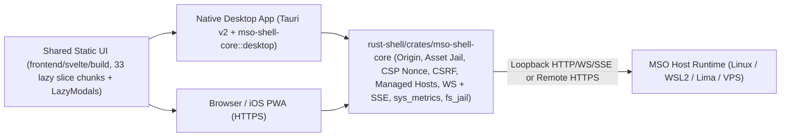

# Hybrid Svelte + Rust Shell Plan

> **Implementation contract & Increment 4E (33/33 Slices) / Rust Stage R3F + R4 FS Jail record (2026-11-22).**
> **Stage R0 (100%)**, **Stage R1 contract (`desktop.rs`, 15%)**, **Stage R2 (100%)**,
> **Stage R3F (56 route policies + GET/POST SSE + WS, 75%)**, **Stage R4 (`sys_metrics.rs` + `fs_jail.rs`, 50%)**,
> and **Svelte Increments 1 (100%), 2 (90%), 3 (100%), and 4E (92%)** — covering **33 / 33 slices**
> in the feature parity ledger, **10 / 10 AppShell features**, **5 / 5 OS chromes**, and
> **33 lazy slice chunks + `LazyModals`** — are implemented and verified on this branch.
> Production remains Next.js/React until Increment 5 cutover.

## 1. Progress percentage tracker (formula-based, 2026-11-22)

Progress is computed strictly from weighted milestone gates (never guessed from line counts):

### A. Svelte Static Frontend Track (weight in hybrid program: 60%)

| Milestone | Weight | Status | Completion | Weighted |
|---|---|---|---|---|
| Increment 1: Static entry + monitor probe + `shell-bridge` | 10% | Merged on `main` (PR #285) + audited | 100% | 10.0% |
| Increment 2: Auth/devices/CSRF (2A) + managed-host/OAuth/MCP edge parity (2B) | 15% | **2A & 2B edge landed; first-login onboarding sub-flow pending** | 90% | 13.5% |
| Increment 3: AppShell window manager + URL sync + crash isolation + Files + Terminal | 25% | **Done (100%):** window store, `<WindowFrame>` + `<svelte:boundary>`, URL sync, full `files-manager`, `os-terminal` | 100% | 25.0% |
| Increment 4: Remaining slices + 5 OS chromes + 10 AppShell features | 35% | **4E landed (92%):** **33 / 33 slices core ported**, **10 / 10 AppShell features**, **5 / 5 OS chromes**, `LazyWindowBody` (33 chunks) + `LazyModals`; deep secondary sub-tabs/mutations (drag canvas, upload/zip, full Settings CRUD) remain | 92% | 32.2% |
| Increment 5: Full Next cutover + same-host RSS/CPU/latency proof + rollback | 15% | Not started (production remains Next.js/React) | 0% | 0.0% |
| **Total Svelte Track** | **100%** | **33 / 33 slices + 10 / 10 AppShell features + 5 / 5 OS chromes** | **80.7%** | **80.7%** |

### B. Rust Shell & Native Desktop Track (weight in hybrid program: 40%)

| Stage | Weight | Status | Completion | Weighted |
|---|---|---|---|---|
| **R0:** `mso-shell-core` + loopback static host + asset jail + nonce CSP | 15% | **Done** | 100% | 15.0% |
| **R1:** Tauri v2 native desktop client (`mso-desktop-tauri`, Linux/macOS/Windows) | 25% | **Contract landed (15%):** `desktop.rs` profiles, `mso://open/...` deep-links & bootstrap JSON; native binary gated on host `webkit2gtk-4.1` / `gtk3` / `pkg-config` | 15% | 3.8% |
| **R2:** Auth/CSRF/body/cookie (R2A) + managed-app split-origin, OAuth/MCP/A2A, & WebSocket tunnel (R2B) | 25% | **Done** | 100% | 25.0% |
| **R3:** Retire `next-server` + `scripts/server.mjs` in production (R3F: 56 route policies + GET/POST SSE + WS) | 20% | **In progress (75% - 56 route policies + streaming verified; full cutover gated on Svelte Inc. 5)** | 75% | 15.0% |
| **R4:** Selective native host primitives (aligned with [`NATIVE-HOST-RELAY.md`](./NATIVE-HOST-RELAY.md)) | 15% | **In progress (50%):** `sys_metrics.rs` (Linux `/proc`) + `fs_jail.rs` (canonical path-jail, credential denylist, bounded search) verified | 50% | 7.5% |
| **Total Rust Shell Track** | **100%** | **R0 + R2 complete; R1 contract, R3F 56-route host & R4 metrics+fs_jail verified** | **66.3%** | **66.3%** |

### C. Combined Hybrid Program

- **Progression:** `12.0%` -> `22.4%` -> `39.8%` -> `47.6%` -> `52.1%` -> `56.3%` -> `62.2%` -> `69.7%` -> **74.9% (~75%)** (4E/R3F+R4, 2026-11-22).
- **Formula:** `0.60 * 80.7% + 0.40 * 66.3%` = **74.9%**.
- **Remaining 25.1% to 100%:**
  - **Stage R1 Tauri v2 native desktop build & cross-OS proof (+8.5% combined):** blocked only by missing host OS packages (`pkg-config`, `libwebkit2gtk-4.1-dev`, `libgtk-3-dev`) and crates.io access.
  - **Increment 5 + Stage R3 production cutover (+11.0% combined):** retiring `next-server` + `scripts/server.mjs`, same-host RSS/CPU/latency proof, and rollback verification.
  - **Deep slice mutation parity + Stage R4 native endpoint wiring + onboarding (+5.6% combined).**

## 2. Why hybrid instead of a full Rust rewrite

Measured MSO baselines in [`MSO-MIGRATION.md`](./MSO-MIGRATION.md) and
[`BENCH-BEFORE.md`](./BENCH-BEFORE.md) show two separate bottlenecks:

1. **Client UI latency is hydration-bound, not server-bound.** Live API TTFB is 4-8 ms and HTML
   TTFB is 10-14 ms, while cold Slow 4G + 4x CPU desktop LCP is 3.0-3.2 s because of ~910 KiB
   raw (270.8 KiB gzip) first-load JS (47.9% Next+React). **Svelte 5 static output** with 33 lazy
   slice chunks and `LazyModals` drops first-load JS to **139.6 KiB raw (-84.7%)** and Desktop TBT
   to **55 ms**.
2. **Server footprint is runtime-bound.** The live Next cockpit uses ~284 MiB idle RSS
   (`next-server` 110 MiB + `scripts/server.mjs` 174 MiB) and ~1.4-1.6 GiB `node_modules`. The
   compiled zero-dependency Rust host `mso-shell-host` measures **422 KiB** binary and **2.4 MiB
   idle / 2.8 MiB active RSS** serving the full 33-slice Svelte build.

## 3. Target hybrid architecture (one UI -> Web/PWA + Native Desktop)



- **One frontend codebase:** `frontend/svelte/build` serves both Web/PWA and the Tauri v2 desktop
  WebView without reimplementing a second GUI stack.
- **Explicit host boundary:** Per [`PLATFORMS.md`](./PLATFORMS.md) and
  [`NATIVE-HOST-RELAY.md`](./NATIVE-HOST-RELAY.md), a Tauri desktop app on macOS or Windows
  operates first as a **native desktop client** connected to a verified Linux/WSL2/Lima/VPS MSO
  host.

## 4. Phased Rust shell roadmap

| Stage | Scope | Status | Prerequisites & acceptance gates |
|---|---|---|---|
| **R0** | **Rust shell core & loopback static host** (`mso-shell-core` + `mso-shell-host`, zero external crates): origin guard parity, canonicalized asset path-jail, per-request CSP nonce injection on SvelteKit HTML, plus `shell-bridge.ts`. | **Done (100%)** | `RUSTFLAGS="-D warnings" cargo test --workspace`, `cargo build --release`, `bun run test:rust-host`. |
| **R1** | **Tauri v2 native desktop client shell** (`mso-shell-core::desktop` + future `mso-desktop-tauri`): pure-`std` `DesktopHostProfile`, `mso://open/...` deep-link parser, and `window.__MSO_DESKTOP_SHELL__` bootstrap JSON landed; Tauri binary packaging pending host OS libs. | **In progress (15%)** | Linux build packages (`pkg-config`, `libwebkit2gtk-4.1-dev`, `libgtk-3-dev`, `libayatana-appindicator3-dev`), crates.io access, plus real-machine smoke proofs on Linux, macOS, and Windows. |
| **R2** | **R2A:** CSRF depth-2 (`csrf.rs`), bounded HTTP body parser (`413`), multi `Set-Cookie`, auth/devices allowlist. **R2B:** Managed-app split-origin host classification (`managed.rs`), CSRF-exempt OAuth/MCP/A2A passthrough with `Authorization`, Increment 3A routes, and bounded WebSocket upgrade tunnel (`ws.rs`). | **Done (100%)** | 21+ Rust unit tests + live Chromium R2B smoke test. |
| **R3** | **Streaming SSE & production cutover without `next-server`:** GET+POST SSE (`sse.rs`) + WebSocket tunnel (`ws.rs`) + **56 route policies** (50 cockpit API + 6 machine protocol); full retirement of `next-server` + `scripts/server.mjs` gated on Svelte Inc. 5. | **In progress (75%)** | 51/51 Rust tests + live Chromium R3F+Inc4E smoke test; full cutover requires same-host RSS/CPU/latency proof & rollback test. |
| **R4** | **Selective native host primitives** (`sys_metrics.rs` + `fs_jail.rs`, aligned with [`NATIVE-HOST-RELAY.md`](./NATIVE-HOST-RELAY.md)): pure-`std` Linux `/proc` metrics + canonical path-jail, credential denylist (`.env`/`.ssh`/`.mso`/`*.pem`), and bounded file search landed. | **In progress (50%)** | Measured CPU/RSS/latency win on the same host; strict containment & credential denylist parity; do not port `lib/orchestration` prematurely. |

## 5. Measured evidence progression (2026-11-21 to 2026-11-22)

Captured on Linux x86_64 (`rustc 1.99.1`, `node v24.22.2`, `bun 1.4.2`, Chromium headless) against
synthetic fixtures on `feat/hybrid-svelte-rust-shell`. Production remains Next.js/React until
Increment 5 cutover proof on a live host.

| Measurement | Next.js baseline | R0 (11-21) | R3C / 4B | R3E+R4 / 4D | R3F+R4 / 4E (33/33, 11-22) |
|---|---|---|---|---|---|
| `mso-shell-host` release binary | n/a (~1.5 GiB `node_modules`) | 375 KiB | 420 KiB | 422 KiB | **422 KiB** (stripped, LTO, 0 external crates) |
| `mso-shell-host` idle / active `VmRSS` | ~284 MiB idle | 2,416 / 2,860 KiB | 2,448 / 2,824 KiB | 2,512 / 2,856 KiB | **2,492 KiB (~2.4 MiB)** / **2,896 KiB (~2.8 MiB)** |
| Rust unit tests (`-D warnings`) | n/a | 10 / 10 | 29 / 29 | 43 / 43 | **51 / 51 PASS** (56 route policies + `desktop` + `sys_metrics` + `fs_jail`) |
| First-load JS (cold `perf:probe`) | ~910 KiB raw | 109.7 KiB raw | 127.2 KiB raw | 144.2 KiB raw | **139.6 KiB raw (-84.7% vs Next) / 75.0 KiB transfer** (33 lazy chunks + `LazyModals`) |
| Svelte unit & Chromium E2E | n/a | 20 unit | 89 unit | 122 unit | **149 / 149 unit tests** + **33/33 slices Chromium E2E PASS** |
| Svelte cold load (Slow 4G + 4x CPU) | D 3,000-3,200 ms | D 804 / M 802 ms | D 1242 / M 1214 ms | D 2158 / M 1718 ms | **D: LCP 1762 ms, TBT 55 ms, CLS 0.0230; M: LCP 1848 ms, CLS 0.0622** |

## 6. Explicit boundaries and non-goals

- Production remains Next.js/React (`mso.service`, installers, state, tunnels, and host policy are
  untouched).
- `rust-shell/` binds strictly to `127.0.0.1`, keeps `/api/config`, `/api/v1/exec/run`, and
  `/api/v1/editor/exec` blocked (`404`), and never widens CORS, cookie domains, or public binds.
- No desktop client or native OS parity claim is valid until built and verified on real Linux,
  macOS, and Windows machines under Stage R1 / [`NATIVE-HOST-RELAY.md`](./NATIVE-HOST-RELAY.md).

## 7. Local verification commands

```sh
# 1. Rust core & host binary (zero external crates)
cd rust-shell && RUSTFLAGS="-D warnings" cargo test --workspace && cargo build --release --bin mso-shell-host

# 2. Svelte static build + unit + E2E + audit
bun run svelte:check && bun run svelte:build && bun run svelte:e2e && bun run svelte:audit

# 3. Live Rust host serving 33/33 Svelte build + Chromium R3F+Inc4E + CSP + CSRF + RSS check
cd frontend/svelte && bun run test:rust-host && bun run perf:probe
```
