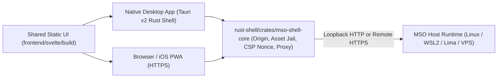

# Hybrid Svelte + Rust Shell Plan

> **Implementation contract & Stage R0 record (2026-11-21).**
> Stage R0 (`rust-shell/` workspace + `frontend/svelte/src/lib/shell-bridge.ts`) is implemented
> and verified on this branch. Stages R1 through R4 are planned with explicit prerequisites and
> cutover gates. Production remains the Next.js/React cockpit until all parity and security
> gates pass.

## 1. Why hybrid instead of a full Rust rewrite

Measured MSO baselines in [`MSO-MIGRATION.md`](./MSO-MIGRATION.md) and
[`BENCH-BEFORE.md`](./BENCH-BEFORE.md) show two separate bottlenecks that require two separate
solutions:

1. **Client UI latency is hydration-bound, not server-bound.**
   Live API TTFB is already 4-8 ms and HTML TTFB is 10-14 ms, while cold Slow 4G + 4x CPU
   desktop LCP is 3.0-3.2 s because of ~910 KiB raw (270.8 KiB gzip) first-load JS, of which
   47.9% (129.6 KiB gzip) is Next+React runtime. Rewriting the backend in Rust alone cannot move
   browser LCP; **Svelte 5 static output** attacks that critical path directly.
2. **Server footprint is runtime-bound.**
   The live Next cockpit uses ~284 MiB idle RSS (`next-server` 110 MiB + `scripts/server.mjs`
   174 MiB) and ~1.4-1.6 GiB `node_modules`. A standalone **Rust shell** solves native desktop
   packaging (Tauri v2) and low-RSS static/proxy serving without rewriting ~100k LOC of portable
   `lib/` orchestration, MCP, OAuth, and A2A code prematurely.

## 2. Target hybrid architecture (one UI -> Web/PWA + Native Desktop)



- **One frontend codebase:** `frontend/svelte/build` serves both Web/PWA and the Tauri v2 desktop
  WebView. Existing web-native surfaces (`xterm.js`, canvas/media editors, iframe managed apps,
  Camoufox noVNC, MCP Apps) remain compatible without reimplementing a second GUI stack.
- **Explicit host boundary:** Per [`PLATFORMS.md`](./PLATFORMS.md) and
  [`NATIVE-HOST-RELAY.md`](./NATIVE-HOST-RELAY.md), a Tauri desktop app on macOS or Windows
  operates first as a **native desktop client** connected to a verified Linux/WSL2/Lima/VPS MSO
  host. Native non-Linux host execution stays gated on real-machine OS adapter proofs.

## 3. Existing Svelte track audit (2026-11-21)

Codebase audit of `frontend/svelte/` against the 33 slices in [`SLICE-CATALOG.md`](./SLICE-CATALOG.md):

| Area | Audited status (2026-11-21) | Notes |
|---|---|---|
| Shipped increments | **Increment 1 only** (PR #285, `1408640f`, 2026-11-09) | Increments 2-5 remain unstarted; subsequent commits only added CI/audit/change-aware gates (`ba44fca3`). |
| Full slices ported | **0 / 33** | 3 partial foundations (`appshell` entry layout, `auth` `/api/auth/me` probe, `system-monitor` one-shot `/api/v1/sys/stats`); 30 slices untouched; 0/5 OS chromes; 0/10 AppShell features. |
| Isolated quality checks | **Green** | `svelte-check` 0 errors/warnings; 20/20 unit tests pass; Vite static build completes in ~216 ms; Playwright browser proof passes across 320/390/1440 px light/dark + auth/error/proxy checks. |
| Defects found & fixed in Stage R0 | **2 fixed** | (1) `tests/perf-probe.mjs` waited for `[data-monitor-state='ready']`, which was absent from `Monitor.svelte` (burning a 20 s timeout per pass) -> fixed and wired to `bun run perf:probe`. (2) Added `src/lib/shell-bridge.ts` fail-closed runtime transport seam for Web vs Rust/Tauri shells. |

## 4. Phased Rust shell roadmap

| Stage | Scope | Status | Prerequisites & acceptance gates |
|---|---|---|---|
| **R0** | **Rust shell core & loopback static host** (`rust-shell/crates/mso-shell-core` + `mso-shell-host`, zero external crates): origin guard parity, canonicalized asset path-jail (blocks traversal, symlinks, reserved `/api/*` fallback), per-request CSP nonce injection on SvelteKit HTML, bounded read-only loopback proxy (`/api/auth/me`, `/api/v1/sys/stats`), plus `frontend/svelte/src/lib/shell-bridge.ts`. | **Implemented on branch** | `RUSTFLAGS="-D warnings" cargo test --workspace`, `cargo build --release`, `bun run svelte:check && svelte:build && svelte:e2e`, and `bun run test:rust-host` (Chromium nonce-CSP proof + live VmRSS check). |
| **R1** | **Tauri v2 native desktop client shell** (`rust-shell/crates/mso-desktop-tauri`): embeds `frontend/svelte/build` + `mso-shell-core`, adds native window chrome, system tray, host profile switcher (loopback WSL2/Lima or remote HTTPS MSO host), OS deep links, and updater. | **Planned** | Linux build host packages (`pkg-config`, `libwebkit2gtk-4.1-dev`, `libgtk-3-dev`, `libayatana-appindicator3-dev`), crates.io access, plus clean real-machine smoke proofs on Linux, macOS, and Windows. Never weakens HTTPS-only remote host policy or cookie isolation. |
| **R2** | **Auth, session, CSRF, CSP & WebSocket proxy parity** (paired with Svelte Increment 2): expand Rust shell router from Stage R0 read-only proxy to full login/device approval, live role checks, CSRF depth-2, split-origin managed-app rewrites, and WebSocket upgrades (`term/*`, Camoufox noVNC, managed apps). | **Planned** | Parity against `proxy.ts` security test suites (`proxy.test.ts`, `proxy-framing.test.ts`, `proxy-websocket.test.ts`, `proxy-machine-protocol.test.ts`); zero second login or cookie-domain drift. |
| **R3** | **Retire `next-server` + `scripts/server.mjs`** (paired with Svelte Increments 3-5): serve static Svelte UI and full edge/WS proxy from the Rust shell while routing `lib/` API/MCP handlers to a single lean runtime process without Next SSR. | **Planned** | Full 33-slice Svelte parity ledger cutover gate, exact-host RSS/CPU/latency benchmark on identical workload, supported `mso update` / rollback path. |
| **R4** | **Selective native host primitives** (aligned with [`NATIVE-HOST-RELAY.md`](./NATIVE-HOST-RELAY.md)): evaluate porting high-I/O host calls (`fs` jail/search, `sys` metrics, `portable-pty`, outbound relay) where measured host resource or native macOS/Windows portability wins justify maintenance. | **Planned** | Measured CPU/RSS/latency win on the same host; strict containment & credential denylist parity; do not port `lib/orchestration` prematurely. |

## 5. Stage R0 measured evidence (2026-11-21)

Captured on Linux x86_64 (`rustc 1.99.1`, `node v24.22.2`, `bun 1.4.2`, Chromium headless) against
synthetic fixtures on `feat/hybrid-svelte-rust-shell`. These figures prove **Stage R0 static host
and Increment 1 Svelte entry behavior only** and must not be represented as full 33-slice cockpit
parity.

| Measurement | Stage R0 measured value | Scope / comparison caveat |
|---|---|---|
| `mso-shell-host` release binary | **375 KiB** (stripped, LTO, 0 external crates) | Static assets + Stage R0 read-only proxy only. |
| `mso-shell-host` idle / active `VmRSS` | **2,416 KiB (~2.4 MiB)** idle / **2,860 KiB (~2.8 MiB)** active | Measured via `/proc/<pid>/status` during live Chromium light+dark run; excludes backend API host process. |
| Nonce CSP & HTTP security boundaries | **Verified in Chromium** (`0` console/page errors) | Fresh 32-char hex `X-Nonce` per HTML request, `script-src 'self' 'nonce-...'` (no `'unsafe-inline'`), wire traversal -> `400`, unlisted `/api/config` -> `404` JSON, non-GET -> `405`, missing asset -> `404`. |
| Svelte static build output | **160 KiB** total dir / **35.3 KiB gzip** total JS (client build 216 ms) | Increment 1 monitor + `shell-bridge.ts` (+468 B gzip). |
| Svelte cold load (Slow 4G + 4x CPU, `perf:probe`) | Desktop: FCP **804 ms**, LCP **804 ms**, TBT **11 ms**; Mobile: FCP **802 ms**, LCP **802 ms**, TBT **22 ms** (87.5 KiB raw JS / 36.0 KiB transfer, 48 DOM nodes) | Synthetic fixture, median of 2 warm-cache-free post-warmup passes; proves minimal Svelte runtime floor, not full 33-slice desktop shell load. |

## 6. Explicit boundaries and non-goals

- Production remains Next.js/React (`mso.service`, installers, state, tunnels, and host policy are
  untouched by Stage R0).
- `rust-shell/` binds strictly to `127.0.0.1` and never widens CORS, cookie domains, or public
  bind addresses.
- No desktop client or native OS parity claim is valid until built and verified on real Linux,
  macOS, and Windows machines under Stage R1 / [`NATIVE-HOST-RELAY.md`](./NATIVE-HOST-RELAY.md).

## 7. Local verification commands

```sh
# 1. Svelte static entry + hybrid shell bridge tests + browser proof + cold-load probe
bun run svelte:check
bun run svelte:build
bun run svelte:e2e
cd frontend/svelte && bun run perf:probe

# 2. Rust shell Stage R0 unit tests + release binary + live Chromium/RSS proof
cd rust-shell && RUSTFLAGS="-D warnings" cargo test --workspace && cargo build --release
cd ../frontend/svelte && bun run test:rust-host
```
