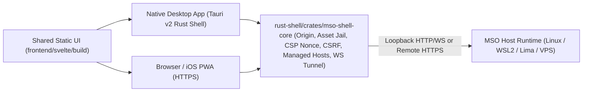

# Hybrid Svelte + Rust Shell Plan

> **Implementation contract & Stage R2B / Increment 3A record (2026-11-22).**
> **Stage R0** (core + static asset jail + nonce CSP), **Stage R2** (R2A auth/CSRF/multi-cookie
> + R2B managed-app split-origin, OAuth/MCP/A2A machine protocols, bounded WebSocket tunnel),
> and **Svelte Increments 1, 2A/2B, and 3A** (core `auth`, AppShell window manager +
> `<svelte:boundary>` crash isolation + History URL sync, `files-manager` browser/preview, and
> `system-monitor` process inventory) are implemented and verified on this branch.
> Production remains the Next.js/React cockpit until all parity and security gates pass.

## 1. Progress percentage tracker (formula-based, 2026-11-22)

Progress is computed strictly from weighted milestone gates (never guessed from line counts):

### A. Svelte Static Frontend Track (weight in hybrid program: 60%)

| Milestone | Weight | Status | Completion | Weighted |
|---|---|---|---|---|
| Increment 1: Static entry + monitor probe + `shell-bridge` | 10% | Merged on `main` (PR #285) + audited | 100% | 10.0% |
| Increment 2: Auth/devices/CSRF (2A) + managed-host/OAuth/MCP edge parity (2B) | 15% | **2A & 2B edge landed; first-login onboarding sub-flow pending** | 90% | 13.5% |
| Increment 3: AppShell window manager + URL sync + Files + Terminal | 25% | **3A landed (window store, `<WindowFrame>` + `<svelte:boundary>`, URL sync, `files-manager` browse/preview); 3B (`os-terminal` + fs write/mkdir UI) pending** | 60% | 15.0% |
| Increment 4: Remaining slices + 5 OS chromes + 10 AppShell features | 35% | `system-monitor` process inventory landed; 29 slices, 5 OS chromes & 10 features pending | 3% | 1.1% |
| Increment 5: Full Next cutover + same-host RSS/CPU/latency proof + rollback | 15% | Not started | 0% | 0.0% |
| **Total Svelte Track** | **100%** | **2 / 33 core slices (`auth`, `files-manager` read) + 2 expanded foundations (`appshell`, `system-monitor`)** | **39.6%** | **39.6%** |

### B. Rust Shell & Native Desktop Track (weight in hybrid program: 40%)

| Stage | Weight | Status | Completion | Weighted |
|---|---|---|---|---|
| **R0:** `mso-shell-core` + loopback static host + asset jail + nonce CSP | 15% | **Done** | 100% | 15.0% |
| **R1:** Tauri v2 native desktop client (`mso-desktop-tauri`, Linux/macOS/Windows) | 25% | Planned (host lacks `webkit2gtk-4.1` / `gtk3` / `pkg-config`) | 0% | 0.0% |
| **R2:** Auth/CSRF/body/cookie (R2A) + managed-app split-origin, OAuth/MCP/A2A, & WebSocket tunnel (R2B) | 25% | **Done (21/21 unit tests + live Chromium proof)** | 100% | 25.0% |
| **R3:** Retire `next-server` + `scripts/server.mjs` in production | 20% | Planned (gated on Svelte Inc. 5) | 0% | 0.0% |
| **R4:** Selective native host primitives (aligned with [`NATIVE-HOST-RELAY.md`](./NATIVE-HOST-RELAY.md)) | 15% | Planned | 0% | 0.0% |
| **Total Rust Shell Track** | **100%** | **R0 + R2 complete** | **40.0%** | **40.0%** |

### C. Combined Hybrid Program

- **After Stage R0 (2026-11-21):** **12.0%**
- **After Increment 2A + Stage R2A (2026-11-22):** **22.4%**
- **Current (after Increment 2B/3A + Stage R2B, 2026-11-22):** `0.60 * 39.6% + 0.40 * 40.0%` = **39.8% (~40%)**
- **When Native Desktop App becomes usable:** Completing **Stage R1 (Tauri v2)** adds +10% combined (~50%) and delivers a native desktop client (Linux/macOS/Windows) wrapping MSO even before all 33 Svelte slices are ported.
- **When production server RAM drops (~284 MiB -> <40 MiB):** Only at **100% cutover (Increment 5 + Stage R3)** when `next-server` + `scripts/server.mjs` are retired.

## 2. Why hybrid instead of a full Rust rewrite

Measured MSO baselines in [`MSO-MIGRATION.md`](./MSO-MIGRATION.md) and
[`BENCH-BEFORE.md`](./BENCH-BEFORE.md) show two separate bottlenecks:

1. **Client UI latency is hydration-bound, not server-bound.** Live API TTFB is 4-8 ms and HTML
   TTFB is 10-14 ms, while cold Slow 4G + 4x CPU desktop LCP is 3.0-3.2 s because of ~910 KiB
   raw (270.8 KiB gzip) first-load JS (47.9% Next+React). **Svelte 5 static output** attacks
   that critical path directly.
2. **Server footprint is runtime-bound.** The live Next cockpit uses ~284 MiB idle RSS
   (`next-server` 110 MiB + `scripts/server.mjs` 174 MiB) and ~1.4-1.6 GiB `node_modules`. A
   standalone **Rust shell** solves native desktop packaging (Tauri v2) and low-RSS static/proxy
   serving without rewriting ~100k LOC of portable `lib/` orchestration, MCP, OAuth, and A2A code
   prematurely.

## 3. Target hybrid architecture (one UI -> Web/PWA + Native Desktop)



- **One frontend codebase:** `frontend/svelte/build` serves both Web/PWA and the Tauri v2 desktop
  WebView. Existing web-native surfaces (`xterm.js`, canvas/media editors, iframe managed apps,
  Camoufox noVNC, MCP Apps) remain compatible without reimplementing a second GUI stack.
- **Explicit host boundary:** Per [`PLATFORMS.md`](./PLATFORMS.md) and
  [`NATIVE-HOST-RELAY.md`](./NATIVE-HOST-RELAY.md), a Tauri desktop app on macOS or Windows
  operates first as a **native desktop client** connected to a verified Linux/WSL2/Lima/VPS MSO
  host. Native non-Linux host execution stays gated on real-machine OS adapter proofs.

## 4. Phased Rust shell roadmap

| Stage | Scope | Status | Prerequisites & acceptance gates |
|---|---|---|---|
| **R0** | **Rust shell core & loopback static host** (`mso-shell-core` + `mso-shell-host`, zero external crates): origin guard parity, canonicalized asset path-jail, per-request CSP nonce injection on SvelteKit HTML, plus `shell-bridge.ts`. | **Done (100%)** | `RUSTFLAGS="-D warnings" cargo test --workspace`, `cargo build --release`, `bun run test:rust-host`. |
| **R1** | **Tauri v2 native desktop client shell** (`rust-shell/crates/mso-desktop-tauri`): embeds `frontend/svelte/build` + `mso-shell-core`, native window chrome, system tray, host profile switcher (loopback WSL2/Lima or remote HTTPS MSO host), OS deep links, updater. | **Planned (0%)** | Linux build packages (`pkg-config`, `libwebkit2gtk-4.1-dev`, `libgtk-3-dev`, `libayatana-appindicator3-dev`), crates.io access, plus real-machine smoke proofs on Linux, macOS, and Windows. |
| **R2** | **R2A:** CSRF depth-2 (`csrf.rs`), bounded HTTP body parser (`413`), multi `Set-Cookie`, auth/devices allowlist. **R2B:** Managed-app split-origin host classification (`managed.rs`, unclaimed namespace `404`, `/_next/*` `404`, `x-os-managed-app-host` stamping/stripping), CSRF-exempt OAuth/MCP/A2A passthrough with `Authorization`, Increment 3A Files/Processes/Term routes, and bounded bidirectional WebSocket upgrade tunnel (`ws.rs`, cap 32 sockets). | **Done (100%)** | 21/21 Rust unit tests + live Chromium R2B smoke test (`bun run test:rust-host`). |
| **R3** | **Retire `next-server` + `scripts/server.mjs`** (paired with Svelte Increments 3B-5): serve static Svelte UI and full edge/WS proxy from the Rust shell while routing `lib/` API/MCP handlers to a single lean runtime process without Next SSR. | **Planned (0%)** | Full 33-slice Svelte parity cutover gate, exact-host RSS/CPU/latency benchmark on identical workload, supported `mso update` / rollback path. |
| **R4** | **Selective native host primitives** (aligned with [`NATIVE-HOST-RELAY.md`](./NATIVE-HOST-RELAY.md)): evaluate porting high-I/O host calls (`fs` jail/search, `sys` metrics, `portable-pty`, outbound relay) where measured gains justify dual-language maintenance. | **Planned (0%)** | Measured CPU/RSS/latency win on the same host; strict containment & credential denylist parity; do not port `lib/orchestration` prematurely. |

## 5. Measured evidence progression (2026-11-21 to 2026-11-22)

Captured on Linux x86_64 (`rustc 1.99.1`, `node v24.22.2`, `bun 1.4.2`, Chromium headless) against
synthetic fixtures on `feat/hybrid-svelte-rust-shell`. These figures prove **Stage R2B static host
and Increment 3A workspace behavior only** and must not be represented as full 33-slice cockpit
parity.

| Measurement | Stage R0 (11-21) | Stage R2A / Inc. 2A | Stage R2B / Inc. 3A (11-22) |
|---|---|---|---|
| `mso-shell-host` release binary | 375 KiB | 383 KiB | **407 KiB** (stripped, LTO, 0 external crates) |
| `mso-shell-host` idle / active `VmRSS` | 2,416 / 2,860 KiB | 2,420 / 2,788 KiB | **2,432 KiB (~2.4 MiB)** / **2,768 KiB (~2.7 MiB)** |
| Rust unit tests (`-D warnings`) | 10 / 10 | 14 / 14 | **21 / 21 PASS** (includes managed hosts, MCP, WS tunnel) |
| Svelte static build output | 160 KiB / 35.3 KiB JS gz | 176 KiB / 41.4 KiB JS gz | **208 KiB** dir / **47.8 KiB JS gzip** (client build 210 ms) |
| Svelte unit & Chromium E2E | 20 unit + Inc. 1 E2E | 26 unit + Inc. 2A E2E | **43 / 43 unit tests** + **Inc. 1 + 2A + 3A Chromium E2E PASS** |
| Svelte cold load (Slow 4G + 4x CPU, `perf:probe`) | D: LCP 804 ms / TBT 11 ms; M: LCP 802 ms / TBT 22 ms | D: LCP 820 ms / TBT 16 ms; M: LCP 824 ms / TBT 18 ms | **Desktop: FCP/LCP 824 ms, TBT 21 ms, CLS 0.0104; Mobile: FCP/LCP 838 ms, TBT 24 ms, CLS 0.0631** (130.1 KiB raw JS / 51.2 KiB transfer, 55 DOM nodes) |

## 6. Explicit boundaries and non-goals

- Production remains Next.js/React (`mso.service`, installers, state, tunnels, and host policy are
  untouched by Stages R0-R2B).
- `rust-shell/` binds strictly to `127.0.0.1` and never widens CORS, cookie domains, or public
  bind addresses.
- No desktop client or native OS parity claim is valid until built and verified on real Linux,
  macOS, and Windows machines under Stage R1 / [`NATIVE-HOST-RELAY.md`](./NATIVE-HOST-RELAY.md).

## 7. Local verification commands

```sh
# 1. Svelte static entry + unit tests (43) + browser E2E + cold-load probe
bun run svelte:check
bun run svelte:build
bun run svelte:e2e
cd frontend/svelte && bun run perf:probe

# 2. Rust shell Stage R2B unit tests (21) + release binary + live Chromium/RSS proof
cd rust-shell && RUSTFLAGS="-D warnings" cargo test --workspace && cargo build --release
cd ../frontend/svelte && bun run test:rust-host
```
